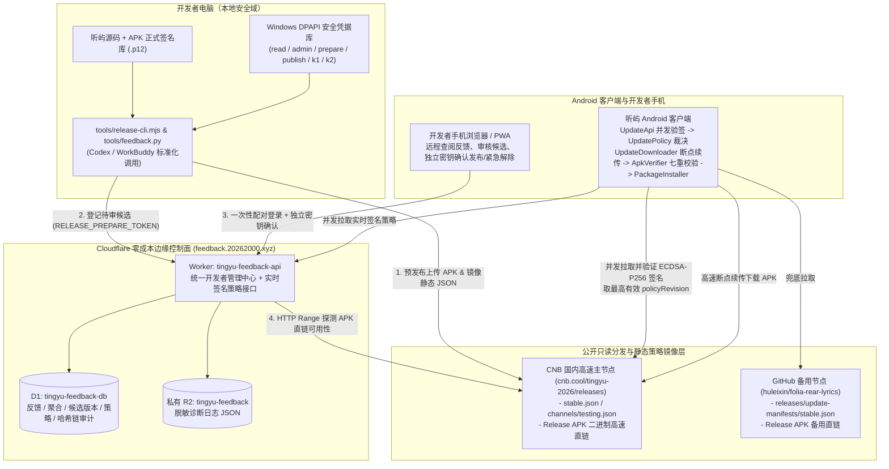

# 听屿开发者管理中心与软件内更新系统架构文档

本文档记录「听屿开发者管理中心（TINGYU · Developer Console）」与 Android 原生软件内安全更新系统的真实生产架构、云资源映射、权限隔离模型、密钥管理方案及零新增固定成本核算。

---

## 1. 总体系统架构

---

## 2. Cloudflare 部署与真实资源映射说明

本系统在原有反馈后台基础上原位平滑扩展，未新建重复后台或付费服务，原有全部用户反馈与私有诊断日志 100% 保留：

| 资源项 | 实际线上配置 | 用途说明 |
| :--- | :--- | :--- |
| **管理中心主入口** | `https://feedback.20262000.xyz/admin` | 桌面端、平板端、手机端响应式后台及可安装 PWA 入口 |
| **Worker 备用入口** | `https://tingyu-feedback-api.2473297053.workers.dev/admin` | 主自定义域名 DNS 波动时的固定同源回退地址 |
| **公开实时策略接口** | `https://feedback.20262000.xyz/api/public/update/:channel` | 返回经 ECDSA-P256 签名的最新渠道策略（`stable` / `testing`） |
| **Worker 服务名称** | `tingyu-feedback-api` | 无服务器边缘路由、PoW 校验、会话鉴权、策略签名与每 30 分钟 Cron 自动巡检 (`*/30 * * * *`) |
| **D1 数据库** | `tingyu-feedback-db` (Binding: `DB`) | `0001_feedback.sql` + `0002_metrics.sql` + `0003_release_console.sql` + `0004_telemetry_and_downloads.sql` |
| **私有 R2 存储桶** | `tingyu-feedback` (Binding: `LOGS_BUCKET`) | 仅通过 Worker 鉴权读取并校验 SHA-256 的脱敏诊断日志 |
| **部署命令** | `python tools/deploy_feedback.py --confirmed-remote-deployment` | 自动执行 D1 增量迁移、通过 `stdin` 注入 DPAPI 密钥并发布 Worker |

---

## 3. 后台鉴权与发布权限四级分离说明

系统严格拆分只读、候选准备、日常管理与正式发布四级权限，杜绝单一 Token 泄露引发恶意推送：

1. **只读权限 (`FEEDBACK_READ_TOKEN` -> `role = read`)**：
   - 允许读取统计概览、反馈列表、脱敏诊断日志、候选记录与发布审计日志。
   - **禁止**修改反馈状态、创建候选、审批版本或调整任何更新策略。
2. **候选准备权限 (`RELEASE_PREPARE_TOKEN` -> `role = prepare`)**：
   - 仅供本机 `tools/release-cli.mjs` 在 `prepare / upload / verify / sync-manifests` 阶段调用。
   - 仅允许写入待审核候选草稿（`POST /api/admin/releases/candidates`）及上报静态镜像同步状态；若修改已审批候选，系统自动清空 `approved_digest`，强制退回待重审状态。
   - **禁止**读取用户诊断日志，**禁止**执行审批、正式发布、暂停或紧急解除。
3. **日常管理权限 (`FEEDBACK_ADMIN_TOKEN` / 手机 5 分钟一次性 `#pairing=` 链接 -> `role = admin`)**：
   - 登录后换取 `HttpOnly; Secure; SameSite=Strict; Path=/api/admin; Max-Age=3600` 短期签名 Cookie，前端零持久凭据存储。
   - 允许流转反馈状态、关联计划修复版本、生成手机端单次配对链接、审核候选并生成防篡改绑定摘要 `approved_digest`。
   - **仅凭管理员会话仍无法直接触发正式发布或策略变更**。
4. **独立发布确认密钥 (`RELEASE_PUBLISH_SECRET` + 一次性防重放 `confirmNonce`)**：
   - 执行 `publish`（正式发布）、`pause`（暂停更新）、`unlock`（紧急解除强制更新）时，除具备 `admin` 身份外，还必须额外验证独立 `X-Publish-Secret`、单次有效 `confirmNonce`（写入 `challenges` 表防重放）及候选版本 `approved_digest` + `expectedSha256`。

---

## 4. 密钥保存、分离与恢复指南

| 密钥 / 凭据名称 | 用途 | 存储位置 | 泄露应急与轮换恢复机制 |
| :--- | :--- | :--- | :--- |
| **Android APK 正式签名库** (`tingyu-release.p12`) | 签署 Android 安装包本身 | **仅存开发者电脑本地** (`private/signing/`)，永不上传任何云端 | Android 系统级信任根，请离线冷备份至加密 U 盘；切勿丢失。 |
| **策略签名主私钥** (`policy_signing_k1`) | 签署更新策略 JSON (`keyId = tingyu-policy-2026-k1`) | 本机 Windows DPAPI (`policy_signing_k1.dpapi`) + Worker Secret (`UPDATE_SIGNING_PRIVATE_KEY_JWK`) | 客户端 `UpdateTrustAnchors.kt` 已同时预埋备用公钥 **`tingyu-policy-2026-k2-backup`**！一旦怀疑 `k1` 泄露，无需发版即可切换 `k2` 私钥签发更高 `policyRevision`。 |
| **策略签名冷备私钥** (`policy_signing_k2_backup`) | 主策略私钥轮换/应急接管 | **仅存本机 Windows DPAPI** (`policy_signing_k2_backup.dpapi`)，默认不上云 | 需要轮换时将其配置为 Worker 新签名私钥，并在下一版客户端移除旧 `k1` 公钥。 |
| **CNB 个人访问令牌** (`.cnb/token`) | 本机 `cnb` CLI 上传 Release 附件与同步静态仓库 | **仅存开发者电脑本地** (`~/.cnb/token`)，未迁移至云端 | 可随时在 CNB 个人设置吊销并重新执行 `cnb login`。 |
| **后台四级业务密钥** (`read` / `admin` / `prepare` / `publish`) | 控制面分级鉴权 | 本机 Windows DPAPI (`C:\Users\DELL\AppData\Local\TingyuFeedback\*.dpapi`) + Worker Secret | 删除对应 `.dpapi` 文件后运行 `python tools/release_credentials.py --prepare` 重新生成高熵随机值，再执行 `deploy_feedback.py` 立即轮换生效。 |

---

## 5. Android 安装流程与本地用户数据保留机制说明

客户端更新安装链路位于 `android/app/src/main/java/io/github/huleixin/tingyu/update/`：

1. **私有专属下载目录**：APK 下载至 `context.filesDir/updates/`（无需任何外部存储写入权限），支持 `StatFs` 剩余空间预检（至少 `apkSize * 2 + 100MB`）与 HTTP `206 Partial Content` 断点续传。
2. **安装前七重硬校验 (`ApkVerifier.kt`)**：
   - 文件存在且字节长度与签名策略 `apkSizeBytes` 完全一致；
   - 流式计算完整文件 `SHA-256` 与签名策略 `sha256` 完全一致；
   - `PackageManager.getPackageArchiveInfo` 校验可正常解析；
   - 包名严格等于 `io.github.huleixin.tingyu`；
   - `versionCode` 严格大于当前运行版本且等于策略声明版本；
   - 设备 `SDK_INT >= manifest.minSdk` 且 `Build.SUPPORTED_ABIS` 与安装包原生库 ABI 兼容；
   - 提取 APK 真实签名证书 SHA-256，必须严格匹配当前已安装应用签名与内置预期指纹 `a36ef2a5324b55d1b8469bd83b081f43ec9c9ce563f0e6cf67567f8ece02249d`。
3. **无损覆盖安装保障**：
   - 同包名 (`io.github.huleixin.tingyu`) + 同正式签名证书标准 Android `ACTION_VIEW` (`FileProvider` 临时只读 URI) 覆盖升级，Android 系统保证**完整保留**内部数据库、IndexedDB/SQLite 歌单、收藏歌曲、已登录音乐平台凭证（Android Keystore + 本地缓存）、推荐偏好、播放历史与本地音频引用，绝不执行卸载重装。

---

## 6. 免费额度与零新增固定运营成本说明

| 平台与资源 | 当前使用档位 | 额度上限 | 听屿实际消耗与保护机制 | 新增月固定成本 |
| :--- | :--- | :--- | :--- | :--- |
| **CNB 公开组织与发布仓库** | 公开开源组织免费档 | 公开 Git 静态文件 + Release 二进制高速分发 | 承载全部约 58MB APK 下载流量，不消耗任何云服务器带宽 | **¥0 / 月** |
| **Cloudflare Workers** | Free Plan | 100,000 次请求 / 天 | 客户端启动与距上次检查 >6h 才检测一次，单接口分钟级限流 | **¥0 / 月** |
| **Cloudflare D1** | Free Plan | 5 GB 存储，500 万行读取 / 天 | 轻量元数据与审计表，过期反馈定时清理 | **¥0 / 月** |
| **Cloudflare R2** | Free Plan | 10 GB 存储 / 月 | 代码级硬限额 `STORAGE_LIMIT_BYTES = 256MB`（当前仅 ~7.5MB），零超额风险 | **¥0 / 月** |
| **GitHub Releases** | 公开仓库免费档 | 静态文件与 Release 附件免费 | 仅作为备用下载源与代码托管 | **¥0 / 月** |
| **AI 自动化能力** | 本地已有 Codex / WorkBuddy | 零云端付费 LLM API 调用 | 后台生成结构化本地 CLI 指令，不调用任何按量计费模型 API | **¥0 / 月** |

---

## 7. 运营数据统计、下载节点巡检与 D1 额度熔断设计（0004 迁移）

### 7.1 新增数据表与存储策略（零无限追加）
- `release_download_stats`：按版本 Tag 存储官方 Release `.apk` 附件信息与已知下载次数。GitHub 官方 `assets[].download_count` 自动同步；CNB OpenAPI 暂未开放附件 `download_count` 字段时，`cnb_downloads` 诚实保持 `NULL`（管理后台展示「暂无统计数据」，绝不伪造为 `0`），同时单独统计客户端软件内更新经 `cnb-primary` 与 `github-backup` 完成下载的真实次数。
- `release_download_snapshots`：按日（北京时间 `YYYY-MM-DD`）记录各版本已知累计下载快照（保留近 180 天），用于计算真实今日新增、昨日、近 7 天及近 30 天增量；无前序快照的日期返回 `null`，绝不编造历史曲线。
- `telemetry_devices`：每台主动开启「匿名使用统计」的设备仅占 **1 行**（主键为服务端加盐不可逆 SHA-256 哈希 `device_hash`，覆盖安装保持同一 UUIDv4 安装编号不变）。
- `telemetry_device_days`：每台设备每天至多 1 行去重活跃记录，保留近 45 天用于精确计算 7 日/30 日活跃及次日/7 日留存率，超期由 Cron 自动归档清理。
- `telemetry_daily_rollups` / `telemetry_monthly_rollups` / `telemetry_update_rollups`：永久小体积日度/月度活跃留存聚合表与更新漏斗聚合表（记录下载发起、下载成功、下载失败、SHA-256 校验失败及**覆盖安装后新版实际首次冷启动确认数**）。

### 7.2 下载节点五态巡检机制
- 巡检触发：部署后首次打开后台自动探测、Worker 每 30 分钟 Cron 自动巡检、新版本签发发布即时回写、后台一键手动立即检测。
- 探测方式：日常采用 `Range: bytes=0-0` 校验非 HTML 二进制响应、HTTP 200/206 状态码与 `Content-Range` 总字节长度；正式发布前由 `release-cli verify` 执行完整 APK 下载与 SHA-256 硬核验。
- 标准五态：`正常`、`异常`、`检测中`、`待配置`、`数据过期`（超过 2 小时未刷新）。

### 7.3 不同用户规模下的 Cloudflare Free 额度消耗评估与熔断保护
- **客户端低功耗模型**：默认关闭（Opt-In）；开启后仅在冷启动上报 1 次，前台使用或后台播放音乐期间默认每 10 分钟上报 1 次（8 分钟内服务端内存级去重零写入），退后台且未播放音乐时立即停止协程。按开启统计的用户日均活跃收听 2 小时估算，单台设备日均仅产生约 `12~14` 次请求、约 `13` 次 D1 行写入。
- **100 日活开启设备**：约 `1,300` 次请求/天（占 Worker 10万/天免费额度的 **1.3%**），D1 写入约 `1,400` 行/天（占 10万写入/天免费额度的 **1.4%**）。
- **1,000 日活开启设备**：约 `13,000` 次请求/天（**13%**），D1 写入约 `14,000` 行/天（**14%**）。
- **5,000 日活开启设备**：原生请求约 `65,000` 次/天；当当日统计写入达到独立预算（默认 `40,000` 次/天，仅为 D1 免费上限的 40%）的 **70%（28,000 次）** 时，服务端自动下发 `nextIntervalSec = 1800`（平滑降频至 30 分钟/次）；达到 **90%（36,000 次）** 时自动熔断暂停当日统计写入，100% 保障软件内更新检查、版本发布、用户反馈与后台鉴权永不受影响。
- **10,000+ 日活开启设备**：通过 70%/90% 双级自动降频与熔断（或管理员在「运营统计」将基础周期调为 `1800~3600` 秒），D1 写入恒定封顶在预算线以内；若未来长期稳定破万日活，届时再按需评估 Workers Paid（$5/月），当前阶段零付费即可安全承载。
