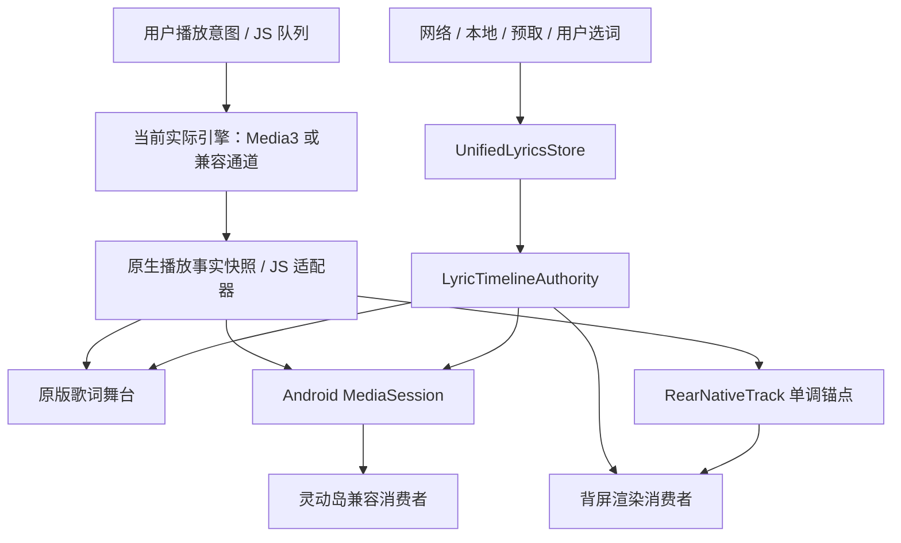

# 听屿第一阶段：播放、歌词与背屏稳定性

研究与开发日期：2026-11-02。源码起点：`dffd06b`（v1.3.88）；本轮没有使用历史缺陷列表替代最新源码检查。

## 1. 参考包、工具与证据边界

已读取上传包中的 README、先前研究报告、应用类/方法索引、focus_methods、xposed_init、rear.js 与前端时钟交付代码。该包不包含完整 APK；原 APK SHA-256 `42e7fa3df4d4edaf3ae98975d58dc4d8bc7e7c46f3de92bd327c8ec8558a244e` 是包内提供的溯源信息，本轮无法重新验证原 APK 签名或整体哈希。

本轮实际校验的 DEX：

| 文件 | SHA-256 |
| --- | --- |
| classes.dex | bb4d71f10c78f58363508719f9f4a40e1036eaab7bae1bc20f3c0fd1f56d7bac |
| classes2.dex | cc77b892636e3e46f9e6e1f5c13f9252ec44dc50c3b87f5ceeae30f9b31ef8b8 |

使用官方 JADX 1.5.6，同时载入两个 DEX，关闭匿名类/方法内联，以便追踪调用；对 PlaybackClock 额外使用 fallback 指令模式。完整反编译报告 314 个错误，不能称为完整恢复源码。重点读取以下恢复结果及方法索引；SuperLyricFeed 的一个回调存在反编译错误，其内部细节不作为结论依据。反编译资料仅保存在工作区研究目录，未复制到听屿源码、资源或安装包。

| 对象 / 方法 | 已观察到的机制 | 不能据此证明的事项 |
| --- | --- | --- |
| FoliaHook.handleLoadPackage / install | 仅匹配 `com.xiaomi.subscreencenter` 包及进程；Hook MAML，并将 RearCardView 放入系统音乐卡片 | 不是听屿 system_server 独立 Activity 路线；没有由此获得 Shizuku 锁屏启动权限 |
| NativeMusicCard.setOwned / Companion.forObject | 只接管匹配的实例；暂停原 MAML 回调，释放时恢复可见性与更新 | 不能证明所有 HyperOS 版本均有同名字段 |
| HostMedia.refresh / updateClock | 比较 MediaSession.Token，重绑 MediaController.Callback；读取 position、lastPositionUpdateTime、speed | MediaSession 存在不等于歌词显示消费者已正确绘制 |
| PlaybackClock.at（索引 code offset 0x1c834c） | playing 才按单调时间差乘 speed 外推，限于时长；fallback 指令再次核对 | 不是另一套播放器或音频同步主时钟 |
| LyricInfoFeed.acceptMedia / stop | player + track id + metadata 辅助匹配；revision / parseRevision 检查解析前后；stop 作废在途工作 | 没有证明任意外部数据源都提供足够身份字段 |
| SelectedLyrics.start / stop | generation 作废旧订阅，选择不同歌词提供方 | 听屿不需要安装或依赖 LyricInfo |
| OrderedLyricCallbacks.offer / close | 有序 worker 准备后派发；close 后不执行旧结果 | 不可把相近类名当成原始 Kotlin 源码 |
| ReferenceSubscriber.bind / releaseRemote | Binder death、订阅令牌、有限连接尝试、解绑；映射共享内存读取位置，协程中有 16ms 本地采样 | 16ms 本地共享内存读取不是 16ms Binder IPC；不移植此依赖 |
| HostLyrics.observe / remove | 观察者共享 feed，最后一个移除后延迟 60s 清理 | 没有真机功耗测量 |
| RearCardView.recoverSnapshot / checkDisplayPower / tick | 显示恢复时 refresh(true)、EngineView.resync；运行期间约 1s 校验媒体状态，按策略 render | 没有证明独立电源租约或相机退出恢复；布局 cameraGap 不构成相机生命周期证据 |
| EngineView.resync / release | 重置已交付配置/歌词 revision，恢复 WebView；释放有清理路径 | 不保证锁屏两小时不会冻结 |

工具来源：[JADX](https://github.com/skylot/jadx)。时钟基准对照：[PlaybackState.getLastPositionUpdateTime](https://developer.android.com/reference/android/media/session/PlaybackState#getLastPositionUpdateTime())。

参考价值分类：A＝采用“恢复时重新同步、异步版本校验、单调媒体锚点”的思路；B＝听屿已经拥有统一仓库、原生锚点、Binder death、生命周期与有界恢复，无需重复；C＝MAML 接管、LyricInfo 依赖及其共享内存协议不直接移植。

## 2. 与当前听屿的逐项对照

| 领域 | 参考 APK | 听屿现有证据 / 本轮处理 |
| --- | --- | --- |
| 曲目身份 | 外部 player、track id、订阅代次 | `getPlaybackSongKey` / MediaItem.mediaId；补前台快照的 provider-aware playbackSongKey，禁止新鲜旧曲目抢权 |
| 时钟 | MediaController + elapsedRealtime 锚点 | Media3 真实位置 → RearNativeTrack；兼容通道仍使用原媒体时钟；补速率、原子快照、事件序号 |
| 歌词数据源 | LyricInfoFeed 等外部提供方 | UnifiedLyricsStore / LyricTimelineAuthority 已裁决版本；保留用户选词、原始时间轴与交付边界偏移 |
| 消费者 | 原生卡片、EngineView | 正面舞台、MediaSession lyricInfo、背屏；补同曲目版本请求隔离和恢复重发 |
| Binder 连接 | 外部歌词服务 death / 令牌 | LspRearBridge / SystemRearBinder 已有 death、协议校验和失联处理，本轮不改 Hook |
| 窗口 | 系统 MAML 宿主视图 | 自有 RearLyricsActivity；既有窗口验证与 renderer 崩溃有限重建保持不变 |
| 锁屏 / 电源 | 宿主生命周期 / AOD 观察 | LSP 已有 60s 租约、正向窗口证据续租及客户端死亡释放；不能由静态代码宣称真机全兼容 |
| 相机 | 关键路径仅确认布局避让参数 | RearOwnershipState / RearHandoffState / RearCameraPolicy 已实现优先让位和恢复，本轮仅把状态交给健康账本 |
| 异常检测 | 状态刷新、resync、fail-open | LyricPublishGuard、LyricSyncLedger、RearFaultDiagnostics 已有；修复旧曲目污染与首次应用超时漏报 |
| 长时续播 | 参考卡片不是播放引擎 | NativePlaylist + QueueSupervision + BackgroundContinuation 已具备无 JS 续播；补终止代次和主线程投递取消边界 |

状态标注：以上“已有”表示源码与自动化策略测试能提供证据，不表示本轮已在手机上跑过。小米系统宿主、真实 Binder 死亡、背屏电源与相机占用的实际效果仍待真机确认。

## 3. 最终职责和数据流

原生实际引擎是听屿自身原生播放的权威；JS Store 是界面镜像和操作意图，不成为第二个原生播放主时钟。兼容输出接管后清空残留 RearNativeTrack，避免已停止的 Media3 仍占有背屏。外部 NowPlaying / stage 输入保留自己的来源时钟；其生命周期回调不接入听屿 Media3 时钟。

身份字段各有职责：engineSessionId 标识引擎实例；source id 标识 JS 媒体适配所有权；原生 track generation / epoch 标识真实曲目变化；eventRevision 对同实例状态包排序；既有 playbackGenerationRef 防止同曲目重新播放的 ABA；歌词仓库 revision/hash 与消费者请求号区分歌词版本。没有把队列更新代次错误地当成所有异步资源的统一失效条件。

## 4. 已确认并修复的缺陷

| 缺陷 | 修改与测试证据 |
| --- | --- |
| 旧窗口的 FINISHED 可以结束更新的队列；applyQueue 仍可能处理旧代次 | QueueSupervision 双向拒绝旧代次；NativeAudioEngine 在修改窗口前拒绝；新增回归在旧代码上失败 |
| 解析完成后到 main 线程接管之间，Pause / Next / cancel 没有二次校验 | BackgroundContinuation 在主线程再核对 request id、锚点、用户意图及逻辑歌单；失败重排也校验；保留普通歌单同步不使有效地址失效的修复 |
| 同一 epoch 的旧歌词请求晚到可覆盖新版本 | rearLyricsTransport 请求号覆盖网络读取和 retry 回调；过期结果只丢弃，不清当前歌词 |
| “前台时间戳新鲜”被误当成“属于当前曲目” | 增加 provider-aware playbackSongKey；新鲜但错曲目仍由原生事实接管；外部 stage 不被残留 Media3 抢权 |
| 消费者 dispose 没清歌词 retry；恢复后只有时钟缺少受控时间轴重发 | 清全部 retry；显示恢复最多 3 次/曲、至少间隔 5s 重读 ready 快照，不清布局、不重建窗口 |
| 状态只凭墙钟排序，迟到 seeked 可越过排序保护 | 原生事件 revision 排序；引擎实例变更可重新建立排序边界，退休实例结果不应用；旧协议兼容保留 |
| RearNativeTrack 分字段快照可混合身份；缺失新元数据仍保留旧标题；速率固定 | 同锁读取完整快照，切曲清元数据；原生速率传到背屏和 MediaSession；detach/release 清理已失效权威 |
| LyricSyncLedger 可被旧曲目 unified / rear ACK 改写，同曲新 epoch 复用旧 ACK | 仅实际曲目/服务更新当前身份，按 key/epoch 拒绝旧回报；切代清交付状态；记录 staleEvents |
| 已交付但从未首次 applied 不会超时；暂停、相机和关闭混入故障 | 增加首次应用等待判定、PAUSED、REAR_DISABLED、REAR_CAMERA_OWNED；睡眠独立标记；协调器只提供观察，无启动/电源行为变化 |
| 手动导入、换词源、匹配等操作在 await 后无条件 setLyrics；同曲重播只校验 key | 复用已有播放代次、库内请求号，加编辑请求号；缓存/当前界面提交边界检查；在线播放歌词回调也检查 landedGeneration |
| 外部 NowPlaying 旧 parse 和旧 host 回调可写入新会话 | 曲目身份/host 生命周期作废解析和回调；不套用 Media3 时钟 |

## 5. 时钟、恢复与诊断

Android 锚点使用 [elapsedRealtime](https://developer.android.com/reference/android/os/SystemClock#elapsedRealtime())，健康账本的时间间隔也统一到这个单调基准。JS 的 performance.now 与 Android elapsedRealtime 原点不同，不能直接相减；桥接继续使用同时采集的 capturedAtMs 估计有限传输延迟（无效/未来/过旧墙钟不补偿），JS 本地外推使用 performance.now。capturedAtElapsedMs 供关联原生诊断；事件排序依赖 revision，避免系统调时把状态排序锁死。暂停/缓冲不外推；Seek、真实曲目变化和速率变化重新锚定。

原生续播保留原有有限解析重试、退避、unsupported 不重试和错误停止边界。没有无限跳过、重建播放器或扩大固定预取窗口。新增校验不会因为一次普通 NativePlaylist generation 更新就丢弃仍有效的已解析地址。

健康链路分层：音乐状态先看实际引擎；歌词 pending/none 区分等待与纯音乐；有词但未写会话属于发布阶段；会话与原生端点已有版本但背屏 ACK 停止属于消费者候选故障。暂停、主动关闭、相机占用、正常睡眠不会按同一错误恢复。

可观测性限制：背屏 applied/heartbeat 证明 JS 应用了数据或事件循环仍活着，不是 GPU 实际呈现帧的证据。灵动岛协议没有通用显示 ACK，本轮只确认 MediaSession 发布与回读，报告明确 `islandConsumerAck=unavailable`。不把“已发布”冒充“系统插件已经显示”。没有凭这种未知状态自动重建 Activity。

入口：设置 → 背屏歌词 → 使用说明 → 展开诊断 → 导出诊断数据。复用现有 buildDiagnosticReport / exportDiagnosticReport / 原生分享；额外模块只在点击导出时加载。关于页仍不恢复诊断按钮。新增导出过滤完整 HTTP/WS URL 和凭据行；新增日志只含匿名曲目标识、代次、计数、原因、时钟及版本，不写 Cookie、Token、完整播放地址或歌词全文。原有日志容量与稀疏心跳保持，未增加持续采样器。

## 6. LSP 与 Shizuku 保护

LSP 继续使用当前系统框架 Hook、Binder 协议和电源租约；Shizuku 继续使用现有 Auto / Reuse / Migrate 路线和系统权限判断。没有将参考 APK 的 MAML Hook 移植进任何一条路线。两者仍由既有后端选择与 camera/ownership 门控管理，不同时争抢显示。协调器改动仅上报健康上下文。

未改：Media3 结构、音源解析器、统一缓存裁决、歌词视觉/逐字动画、主题、Liquid Glass、SVG、搜索、定时器、队列持久化格式。改动涉及播放状态交付校验和必要的 MediaSession 速率上报，但没有重建引擎或加入新后台服务。

## 7. 自动化验证与边界

测试及构建结果见随版本提交的 `PLAYBACK_STABILITY_STAGE1_VALIDATION.md`。新回归先在原代码上实际得到 4 项前端失败和 2 项 JVM 失败，再实施修复。两项扩大回归中的旧测试假设在独立 v1.3.88 worktree 中同样失败：已将空 error 改成真实原生解码失败包，将 blob 断言改成已有退休/安全回收机制；没有改播放器去迎合旧假设。

连续 10/30/50 首测试用真实 NativePlaylist、BackgroundContinuation 和解析器注册链路，模拟引擎及网络结果；JS 全程不补队列。50 首三端版本测试用真实统一仓库、裁决和桥缓存。两小时模拟测试以 7200 个一秒样本跨 40 首，覆盖暂停、速率变化和后退 Seek。它们不能证明真实 Media3 解码、网络、系统杀进程、锁屏或背屏功耗已通过。

## 8. 真机 1–2 小时验收方案

1. 同签名覆盖安装，保留用户数据；记录机型、HyperOS、背屏中心、LSPosed/Shizuku 版本及选定后端。两个后端分开跑，不同时启用。
2. 选 50 首混合来源歌单（含本地、同名不同版本、无词、慢歌词），关闭正面舞台后锁屏连续播放。至少各记录 10、30、50 首边界；总运行 1–2 小时。
3. 每 15–20 分钟执行一次暂停/恢复、Seek、上一首/下一首；另做 20 次快速切歌及随机/单曲循环/列表循环。
4. 在两首切换时断网 30s 后恢复，确认有限重试和明确终止原因；不能接受无限跳曲或不断重建播放器。
5. 打开相机占用背屏 30s 后退出，重复 3 次；确认主动让位、无常亮抢占、恢复时当前曲目及偏移一致。
6. LSP 测试 Binder/模块断开重连；Shizuku 测试授权撤销与恢复，锁屏拒绝启动要如实记录，不视为突破限制成功。
7. 观察背屏、灵动岛、正面舞台的同一句及版本；系统插件无 ACK 时通过屏幕录像核对，不能只看日志判通过。
8. 异常后立刻通过上述入口导出报告，附上精确发生时间、前台/锁屏/相机状态和录像；不需要连接电脑。
9. 对照同设备 v1.3.88 测温、电量、CPU/唤醒与日志容量。当前没有真机功耗数据，不宣称功耗下降或续播成功率达到某值。

## 9. 性能与回滚

常态新增工作是整数/身份校验和现有快照的少量字段；未新增正常状态的 Binder 轮询、网络心跳或模糊层。恢复请求按事件触发并有限额，不定时搬运整份歌词。诊断导出按需加载。新增 synchronized 仅保护内存状态和 JSON 快照，不在锁内联网或写盘。

按独立提交分别回滚“原生状态/续播校验”和“异步歌词/恢复/诊断”。已发布代码可用 git revert 反向提交，再以更高 versionCode 和原签名构建覆盖包；不要通过卸载或清数据回滚。新增字段可选，持久化格式未变，缓存与播放列表无需迁移或清空。
